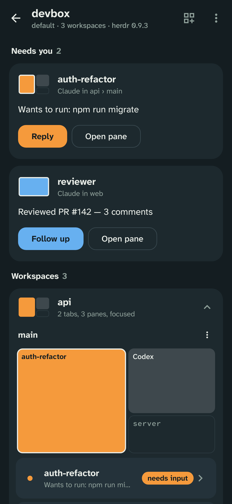
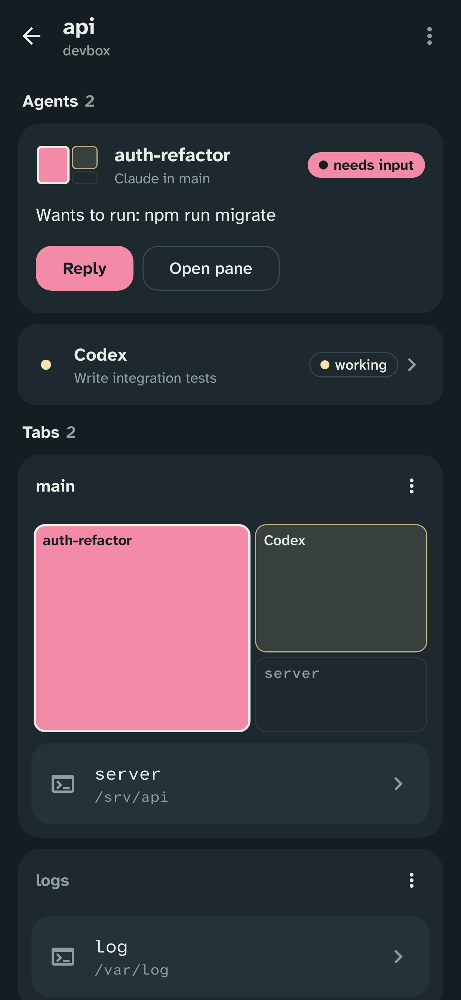
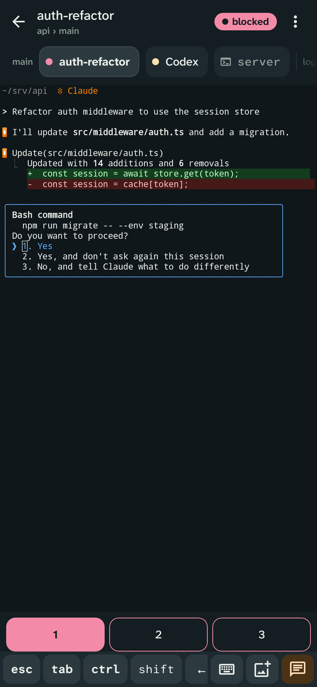
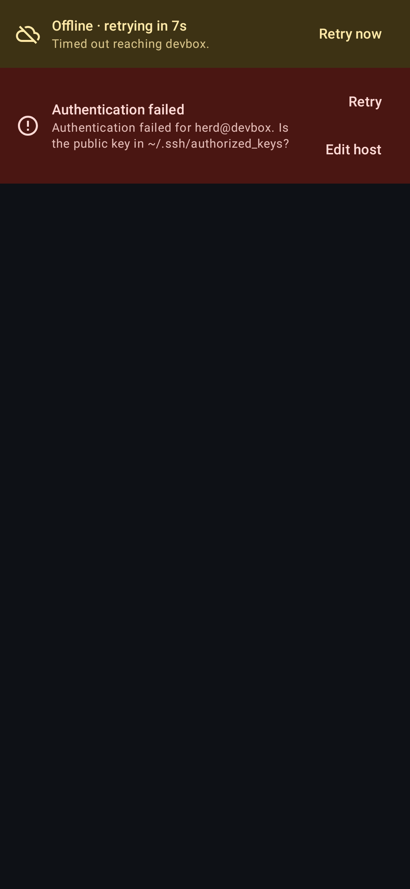

# wooloo-mobile

The Android companion to [wooloo](https://github.com/rarce/wooloo), built with Kotlin + Jetpack Compose for [herdr](https://github.com/herdrdev/herdr), the terminal
multiplexer for coding agents. wooloo mobile connects over SSH and uses herdr's own protocols to show your agents and
workspaces, let you reply to them, and drive any pane from your phone.

| Your spaces | Inside a space | Live pane | Connection states |
| --- | --- | --- | --- |
|  |  |  |  |

## Install and first connection

Requires Android 8 or newer and a reachable SSH account with herdr installed.
Open [latest release](https://github.com/rarce/herdroid/releases/latest) and choose its
`wooloo-mobile-X.Y.Z.apk`. If no release is available, distribution is not ready;
do not use a debug or smoke-test APK as a production release. Compare the published
SHA-256 and signer fingerprint, allow installation for your browser when Android asks,
and open the app. In-app updates need a separate installation permission for wooloo mobile.
See [update and recovery instructions](docs/updates.md), including transition from debug installs.

Generate a phone key and authorize its **public** key as described below. Add a machine
manually or import its QR, verify the server fingerprint through a trusted channel,
select the authorized key, then Connect → space → agent → terminal. A QR does not grant
network access or authorize the key. Keep another working server login for recovery.

## Privacy, license and support

Read the [privacy policy](app/src/main/assets/legal/privacy.txt), also available offline
in Settings. Quotas are experimental and require per-identity consent to read remote
agent tokens and query providers from the phone. Disabling them does not disable SSH.
The project code is [MIT licensed](LICENSE); dependencies retain their own licenses (see the [resolved inventory](docs/dependencies.md)).
The launcher uses the readable name **wooloo mobile**. Provider names identify
interoperability and do not imply endorsement.

Report sanitized bugs through [GitHub Issues](https://github.com/rarce/herdroid/issues).
Read [security reporting](SECURITY.md) before reporting a vulnerability. The
[release checklist](todo.md) tracks production signing, public availability and remaining validation.

## How it talks to herdr

Everything runs over **one SSH connection** (sshj). Nothing needs to be installed on the server besides herdr, and
no ports are opened:

| Purpose | Remote command (exec channel) | Protocol |
| --- | --- | --- |
| API calls (snapshot, create/rename/close, split, zoom, prompt…) | `herdr --session <s> remote-api-bridge` | herdr socket API: newline-delimited JSON, one request per connection |
| Live updates | same bridge, kept open with `events.subscribe` | lifecycle events + per-pane `pane.agent_status_changed` |
| Live terminal | `herdr --session <s> terminal session control <pane> --cols C --rows R [--takeover]` | NDJSON `terminal.frame` records (base64 ANSI) out; `terminal.input` / `resize` / `scroll` / `mouse` / `release` in |
| Watch-only | `herdr terminal session observe <pane>` | same frames, read-only |

The SSH connection is either a direct TCP port or a **Cloudflare Tunnel** (e.g. wooloo's Remote Access, or
`cloudflared tunnel --url ssh://localhost:22`). For a tunnel, wooloo mobile opens a WebSocket to `wss://<hostname>/` and
carries the raw SSH stream in binary messages, exactly like `cloudflared access ssh`, so no `cloudflared` is needed
on the phone. Hostnames behind Cloudflare Access take a service token (`CF-Access-Client-Id` / `-Secret`).

`remote-api-bridge` is the stdio bridge herdr uses for its own saved SSH machines. As herdr's docs recommend,
events only *invalidate* state, and the authoritative view always comes from `session.snapshot`.
Non-interactive SSH sessions often lack `~/.local/bin` on `PATH`, so the app looks for herdr in the usual install
locations, or uses the path you set per host.

API calls and subscription handshakes have a 20-second deadline, including exec-channel acquisition.
Cancellation interrupts channel IO; if it remains blocked after 250 ms, the app closes the SSH transport
so reconnect can recover it. Graceful channel cleanup runs on an IO thread with a separate 250 ms budget;
it can add that cleanup time to a request deadline. A peer that never acknowledges channel closure also
causes a transport reset. Cancelling an interruptible subscription normally preserves the shared transport.

Requires a herdr server with `terminal session control` and `remote-api-bridge`. Tested end-to-end against
**herdr 0.9.3** historically, and **herdr 0.9.5 / protocol 22** against an isolated
real SSH fixture on 2026-10-17. See [live validation](docs/release-readiness/live-validation.md)
for executed checks and remaining release gates.

## UX highlights

- **Spaces first, like herdr's sidebar.** A machine opens on its spaces (herdr workspaces). Spaces and agents
  keep the order supplied by herdr, without moving when their state changes. Space states come directly from
  the server. Agents use compact rows: tap to open the pane, or use the message button to reply.
- **Grouped lists.** Machines, spaces and agents share aligned rows and quiet dividers. Agent names,
  states and tasks have distinct places; larger text moves the state below the name. A neutral rail marks
  herdr's focus, independently of state. Spaces show their active tab's layout before opening them.
- **Consistent states.** Every list uses herdr's marks and colors: working is yellow, blocked red, done teal,
  idle green, and unknown gray. Machine connection status is separate from its agent counts, including idle
  and unknown agents. Cached agent states are labeled while disconnected.
- **Layout miniature.** Each tab is drawn with herdr's real pane geometry, colored by agent state. It identifies
  the panes inside a space and doubles as the terminal pane switcher. Tap a pane to open it.
- **Composer for agents.** A real multi-line text field (autocorrect, swipe typing, voice) that sends with
  `agent.prompt`, plus one-tap quick replies (`Enter`, `1/2/3`, `y/n`, `Esc`, `⇧Tab`, `Ctrl-C`) for permission prompts.
- **Terminal built for touch.** Server-rendered frames drawn on a Canvas. Swipe scrolls herdr's scrollback with
  fling, pinch zooms (and resizes the remote pane), and tap clicks for mouse-aware TUIs. The IME bridge turns
  Gboard/SwiftKey composition and dictation revisions into correct keystrokes, with readable text/cursor
  context for the keyboard. The active pane retains input focus unless a dialog or composer is open. Long-press to copy a line, the screen, or 400 lines of
  history, or to open OSC 8 links.
- **Extra keys.** Sticky `ctrl`/`alt`/`shift` (tap applies to the next key; double-tap locks), auto-repeating arrows, `esc`, `tab`, `^C`, symbols,
  `pgup`/`pgdn`, and bracketed paste.
- **Moving between agents.** Inside a pane, swipe the title sideways or tap the miniature to move between the
  space's agents. When an agent in another space needs you, a snackbar offers to jump to it through its space.
- **Shared control.** If your desktop herdr already controls a pane, you can choose **Take control** or
  **Watch only**. If someone takes control from you, you can take it back.
- **Resilient connections.** Automatic reconnect with backoff, plus an immediate retry when the network returns.
  While offline, the last state stays on screen, dimmed. Errors name their fix (auth → check `authorized_keys`,
  herdr missing → set its path).
- **Notifications.** A foreground service keeps connections alive and posts a notification when an agent blocks
  or finishes. Tapping it opens that agent's pane.
- **Keys and security.** Generate an Ed25519 key on the phone (with **Copy public key** and sharing) or
  import OpenSSH/PEM/PKCS#8 keys. Private keys and saved passwords are encrypted with the Android Keystore. Host
  keys are trust-on-first-use, with a loud warning if a key changes.
  Editing an existing machine's destination or trusted keys requires an explicit review before saving or
  connecting, including any saved password or Cloudflare Access secret that will be reused. Unsaved password
  and token drafts are cleared when Android recreates the editor; saved encrypted credentials are preserved.
- **Direct SSH, Cloudflare and QR import.** In wooloo, select the machine and open **Remote Access**.
  Its direct SSH QR carries that server's address and port; your phone must be able to reach them.
  Cloudflare Tunnel is an option for the local Mac. Use **Scan QR** in the mobile machine list to scan,
  choose a QR image, or paste the copied machine link. The bundled reader works offline and camera permission
  is requested only when opening the scanner. A compatible `herdroid://add-host?…` link opens the host editor
  prefilled with the transport, host, SSH port, user, session, herdr path and host key fingerprints. Imported
  fingerprints pin the server key; changing a saved machine's destination or pins first requires a trust review.
  Review the details and fingerprints, choose an authorized SSH key or password
  and tap **Connect**. The QR carries connection details, not SSH credentials; a link never connects by itself.
  Quick tunnel hostnames change on every restart, so scanning a new code updates the matching machine (same
  name, user and session) instead of adding a duplicate.
- Pastes like `user@host:2222` (or a tunnel's `https://` URL) are split into separate fields automatically.
  Several machines can be connected at once.

## Authorize your phone in wooloo

1. In wooloo mobile, open **SSH keys** and generate a key or select an existing one. Tap **Copy public key**;
   this copies the public key itself, without a shell command. Keep the private key on the phone.
2. In wooloo on your Mac, select the local or remote SSH machine and open **Remote Access**. Paste the public key,
   review the destination account, public key fingerprint and `authorized_keys` path, then authorize it on that machine.
3. Scan that machine's QR in wooloo mobile, review the connection details and choose the matching phone key.
   For direct SSH, the phone needs network access to the server's host and port; a QR does not create a tunnel.
   Cloudflare Tunnel is available for the local Mac.

You can also append the copied public key manually to the destination account's `~/.ssh/authorized_keys`.
Existing `herdroid://add-host` links remain compatible, including links without an explicit transport (SSH).

## Naming and compatibility

The app and Gradle project are named **wooloo mobile** (`wooloo-mobile` in Gradle). The existing Android
application ID and Kotlin namespace (`dev.herdroid`), encrypted storage identifiers, `HERDROID_*` test
variables and `herdroid://add-host` links stay compatible with earlier installs and wooloo's QR codes.
Updating the app keeps saved machines, keys and preferences.

## Project review

See the [technical review from October 11, 2026](docs/review-2026-10-11.md) for build validation,
prioritized reliability findings and improvements required before distribution.

## Build

```bash
./gradlew assembleDebug            # app/build/outputs/apk/debug/app-debug.apk
./gradlew testDebugUnitTest        # unit tests (emulator, key encoding, protocol, models)
./gradlew assembleRelease          # unsigned, minified APK for distribution signing
```

Optional checks:

```bash
# Ed25519 generation, import and signature rejection on the minified APK in an isolated emulator.
# This flag signs release with the debug key only for the smoke test; do not distribute that APK.
./gradlew connectedReleaseAndroidTest -PreleaseSmoke

# End-to-end against a real herdr over SSH (appends a generated test key to the given authorized_keys)
HERDROID_E2E_HOST=127.0.0.1 HERDROID_E2E_PORT=2222 HERDROID_E2E_USER=herd \
HERDROID_E2E_AUTHORIZED_KEYS=/home/herd/.ssh/authorized_keys ./gradlew testDebugUnitTest --tests '*HerdrEndToEndTest*'

# Through a real Cloudflare quick tunnel (`cloudflared tunnel --url ssh://localhost:22`)
HERDROID_CF_TUNNEL_HOST=name.trycloudflare.com ./gradlew testDebugUnitTest --tests '*CloudflareTunnelSocketTest*'

# Re-render the screenshots above (Robolectric native graphics, no device needed)
./gradlew testDebugUnitTest -Pscreenshots --tests '*ScreenshotsTest*'
```

Requires JDK 17+ and Android SDK 36. minSdk 26.

The release smoke suite selects only `ReleaseCryptoTest` from `app/src/releaseSmokeTest/`.
The debug device suite includes that shared crypto test and the Compose UI tests in
`app/src/androidTest/`. This keeps the minified crypto check focused without preserving the
entire Compose test framework's target ABI in the release app. Device UI checks against the final
signed APK remain a separate release requirement.

## Layout

```
app/src/main/java/dev/herdroid/
  ssh/          SshSession: sshj transport, TOFU host keys, key/password/keyboard-interactive auth;
                CloudflareTunnelSocket: SSH over a Cloudflare Tunnel WebSocket
  herdr/        HerdrApi (socket API over remote-api-bridge), TerminalStream, models, RemoteCommand
  connection/   HerdrConnection (lifecycle, reconnect, event-driven refresh, alerts), ConnectionManager, Notifier
  terminal/     TerminalEmulator (ANSI → grid), TerminalView (Canvas renderer + IME + gestures), KeyEncoder
  data/         host profiles, Keystore-backed secrets, SSH key manager, known hosts
  ui/           Compose screens: hosts, host editor, keys, session, terminal, settings
```
